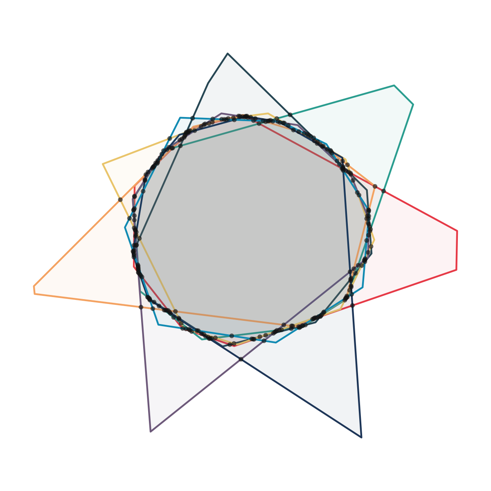

# Simple Convex 8-Venn Diagram with 8 Uniform Octagons (k*(8) <= 8)



## Summary
Compact integer-lattice (Z^2) realization and standalone verification artifacts certifying **8 strictly convex octagons** forming a **simple monotone 8-Venn diagram** (V = 254 pairwise-distinct transversal crossings, E = 508, F = 256 connected regions).

- **Polygon complexity:** 8 strictly convex octagons (K = 8 sides each)
- **Compact Z^2 realization:** All 64 vertices lie on Z^2 inside [-589, 589]^2 (uniform scaling denominator D = 9; compact realization, not a proof of global lattice minimality)
- **Simple arrangement:** Exactly V = 254 distinct transversal crossings, 0 triple points, 0 vertex-on-edge contacts, every pair crosses >= 2 times (max pairwise = 14)
- **All 256 regions witnessed:** 256 exact integer-scaled witness points (S_w = 2) strictly separating all 256 subsets
- **Context:** Against Grunbaum (1975) k*(8) <= 64 and Carroll-Ruskey-Weston (2007) k*(8) >= 6, this explicit construction certifies k*(8) <= 8, leaving k*(8) in {6, 7, 8} open.

## Verification
```bash
python verify_z2_certificate.py CERTIFIED_SIMPLE_8_VENN_k8_Z2.json
lean SimpleConvex8VennK8.lean
```
SimpleConvex8VennK8.lean (zero sorry, zero Mathlib, zero native_decide) verifies purely inside the Lean 4 kernel (decide) strict simple convexity of all 8 octagons, zero degenerate contacts, exact V = 254 distinct crossings with >= 2 crossings per pair, and strict separation of all 256 witnesses. Classical planar topology (Jordan Curve Theorem + Euler formula F = E - V + 2 = 256 + Pigeonhole Principle) bridges these algebraic invariants to connectedness of all 256 Venn regions.
